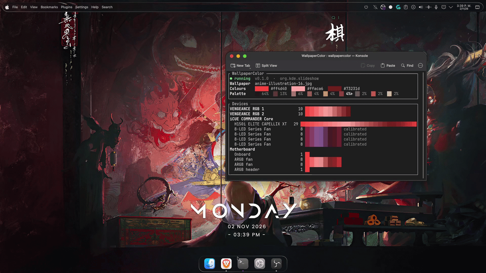

# Wallpaper Color - KDE Plasma

Paints your PC's RGB lighting with the colours of the wallpaper on screen, including the current
slide of a KDE Plasma slideshow. When the wallpaper changes, the RAM, the AIO pump, the fans and
the motherboard fade to its colours.

## See DEV Notes

DEV Notes: [What's' is this project even about](docs/ARCHITECTURE.md).

- **`wallpapercolord`**: the background service. Light and event-driven: about 7.5 MB of RAM and
  no CPU while nothing changes.
- **`wallpapercolor`**: a terminal UI to watch and configure it, plus commands. The service
  works without it.

Written in C++23. [docs/ARCHITECTURE.md](docs/ARCHITECTURE.md) explains how it works and where
everything is in the code.

<p align="center">
  
</p>

## Requirements

| What | Why |
| --- | --- |
| Linux with **KDE Plasma** (tested on 6.8) and a systemd user session | The picture on screen comes from Plasma over D-Bus. |
| **[OpenLinkHub](https://github.com/jurkovic-nikola/OpenLinkHub)** 0.9.4 or newer, running | It drives the Corsair devices (RAM, AIO, Commander Core fans…). WallpaperColor sends it colours through its built-in OpenRGB SDK server. Any other OpenRGB SDK server works too (OpenRGB itself listens on port 6742). |
| Optional: a **Gigabyte motherboard with RGB Fusion 2** (USB controller `048d:5702` or `048d:8297`) | Its onboard lights and its ARGB headers are painted directly, with no extra program. |
| glibc 2.39 and libstdc++ from GCC 14 or newer, x86-64 (Ubuntu 24.04, Fedora 40, Debian 13, Arch and newer) | For the prebuilt release. Building from source has no such limit. |
| Only to build from source: GCC 14 or newer (C++23; tested with GCC 16), CMake, Ninja, the libraries in [Build from source](#build-from-source) and internet on the first build | CMake downloads FTXUI (the terminal UI library) once. |

## Install

### 1. Let OpenLinkHub take colours from outside

1. In `/var/lib/openlinkhub/config.json`, set `"enableOpenRGBTargetServer": true` (the port is
   `"openRGBPort": 6743`), then restart it: `sudo systemctl restart openlinkhub`.
2. Open the OpenLinkHub web page (by default <http://127.0.0.1:27003>) and, for **each device**
   you want painted, turn on **OpenRGB Integration**. Devices with it off keep their own
   OpenLinkHub effects and are not touched.

### 2. Download and install

Download `wallpapercolor-<version>-x86_64.tar.gz` from the
[latest release](https://github.com/AndruTRADX/WallpaperColor/releases/latest). The programs
come ready to run: nothing to compile and no libraries to install.

```sh
tar xzf wallpapercolor-*-x86_64.tar.gz
cd wallpapercolor-*-x86_64
./install.sh
```

`install.sh` installs `~/.local/bin/wallpapercolor`, `~/.local/bin/wallpapercolord` and the
driver modules in `~/.local/lib/wallpapercolor/drivers/`, and enables and starts the
`wallpapercolord` user service. It starts with your graphical session
from then on. `./install.sh --no-start` installs without starting it. To update, download the
new release and run its `install.sh`.

Make sure `~/.local/bin` is in your `PATH`.

To build it yourself instead, see [Build from source](#build-from-source).

### 3. Optional: the motherboard's RGB

Only for Gigabyte boards with RGB Fusion 2. A udev rule lets the person logged in use the
controller, so the service doesn't need root. From the release folder:

```sh
./install.sh --udev
```

From a clone of the repository, install it by hand:

```sh
sudo install -Dm644 udev/70-wallpapercolor.rules /etc/udev/rules.d/70-wallpapercolor.rules
sudo udevadm control --reload && sudo udevadm trigger --subsystem-match=hidraw
```

### 4. Check it works

```sh
wallpapercolor devices   # what every driver finds, zone by zone, and what each zone is
wallpapercolor status    # what the service is doing
```

If the `openrgb` driver finds no devices, OpenRGB Integration is still off for every device
(step 1).

### 5. Choose what is painted

Run `wallpapercolor` and press `d`: the Drivers page lists fans, pump, RAM, motherboard, ARGB
headers… with what was found for each. Untick what WallpaperColor should leave alone. The
service keeps a driver in memory only while something it paints is ticked: with RAM, pump and
fans unticked, the `openrgb` driver isn't loaded at all. The same from the command line:

```sh
wallpapercolor drivers              # what is ticked, and which driver paints it
wallpapercolor drivers off ram      # leave the RAM to OpenLinkHub
wallpapercolor drivers on ram
```

Until you change something there, everything is painted.

### 6. Optional: fans or strips on the motherboard's ARGB headers

Until you describe them, each header is painted in one colour. To paint them LED by LED (a
gradient around each fan), list the LEDs of every fan chained on each header in the config
(see [Configuration](#configuration)):

```toml
[motherboard]
argb_header1 = [8, 8]   # two fans of 8 LEDs, one after the other
```

If they show the wrong colours (blue looks green, for example), change `argb_order`. Most
fans are `"GRB"`.

### Build from source

Install the build tools and libraries. On Arch / CachyOS:

```sh
sudo pacman -S --needed base-devel cmake ninja stb libjpeg-turbo libpng libwebp tomlplusplus nlohmann-json cli11 sdbus-cpp doctest
```

On other distributions, install the equivalents: stb (`stb_image.h`), libjpeg-turbo, libpng, libwebp, toml++,
nlohmann-json, CLI11, sdbus-c++ 2.x and doctest. Then:

```sh
git clone https://github.com/AndruTRADX/WallpaperColor.git
cd WallpaperColor
./install.sh
```

This `install.sh` builds, runs the tests and installs just like the release one (same
`--no-start`). Run it again after pulling changes.

### Making a release

`packaging/release.sh` builds the portable tarball into `dist/`: every library except glibc,
libsystemd and zlib is linked into the binaries (`-DWPC_PORTABLE=ON`). Pushing a tag that matches the
version in `CMakeLists.txt` makes GitHub Actions build it on Ubuntu 24.04 and publish the
release:

```sh
git tag v0.1.0 && git push origin v0.1.0
```

## Commands

Every command accepts `--config FILE` to use another config file
(default `~/.config/wallpapercolor/config.toml`), plus `-h` / `--help` and `-V` / `--version`.

| Command | What it does |
| --- | --- |
| `wallpapercolor` | Opens the terminal UI (same as `wallpapercolor tui`). |
| `wallpapercolor status` | What the service is doing: running or paused, the wallpaper, its colours, the devices, the last problem. |
| `wallpapercolor pause` | Stops sending colours; the devices keep the last ones. The service keeps running. |
| `wallpapercolor resume` | Starts sending colours again (and sends the current ones). |
| `wallpapercolor apply` | Sends the current wallpaper's colours again now. |
| `wallpapercolor devices` | Lists what every installed driver finds: devices, their zones and LEDs, what each zone is (fans, pump, RAM…) and whether it is painted. |
| `wallpapercolor drivers` | Shows which components are painted and which driver paints each. `drivers on fans pump` / `drivers off ram` chooses them. |
| `wallpapercolor set COLOUR...` | Paints every chosen component once with one to three colours (`#rrggbb` or `rrggbb`). |
| `wallpapercolor set --image PICTURE` | Paints every chosen component once with the colours of a picture. |
| `wallpapercolor extract PICTURE...` | Shows the colours that would be taken from pictures, without painting anything. `-p` / `--palette` also shows the palette they were picked from. |
| `wallpapercolor config` | Prints the configuration in use, defaults included. |

`set` takes `--arc`, `--single` or `--split` to choose how the colours are spread (see `mode`
below); without them it follows the config. The service paints over `set` at the next wallpaper
change: run `wallpapercolor pause` first to keep them.

Examples:

```sh
wallpapercolor set ff0000                         # everything red
wallpapercolor set ff0000 00ff00 0000ff --arc     # a red, green and blue gradient
wallpapercolor extract -p ~/Pictures/wallpapers/*.jpg
```

## Terminal UI

Run `wallpapercolor`. At the top: the service state, the wallpaper, its colours and the palette
they came from. In the middle: a live preview of every device and zone. At the bottom: the
settings, saved to the config file as you change them (your comments in the file are kept) and
applied by the service within a second.

| Key | What it does |
| --- | --- |
| `↑` `↓` (or `k` `j`) | Select a setting |
| `←` `→` (or `h` `l`) | Change it |
| `Enter` | On "+ Calibrate": add a calibration for the chosen device or zone |
| `x` (twice) | On a calibration: remove it |
| `w` | White test: everything turns white, to compare devices while adjusting calibrations; `w` again ends it |
| `d` | The Drivers page: tick what is painted (`space`), look for hardware again (`r`), back (`Esc`) |
| `p` | Pause or resume the service |
| `a` | Send the colours again |
| `q` / `Esc` | Quit (the service keeps running) |

## Configuration

`~/.config/wallpapercolor/config.toml`. Every key is optional; these are the defaults. The
service reloads the file when it changes. A mistake (an unknown key, a wrong type) is reported in
the service log, and the defaults are used until it is fixed.

```toml
[led]
mode = "arc"        # "arc": the three colours as a gradient (around fans and the pump, top to
                    #   bottom on RAM); "single": the main colour everywhere;
                    #   "split": one colour per kind of zone (RAM, pump, fans…)
fade = 0.6          # seconds a colour change takes (0 = at once, at most 1.5)

[extract]           # how colours are picked from the picture
min_saturation = 0.7    # "intensity": how saturated dark and dull colours become (0.2-1)
pastel_gain = 2.5       # how much light, soft colours are strengthened
skin_weight = 0.15      # how much skin tones count (0 = never picked, 1 = like any colour)
min_chroma = 0.06       # colours duller than this count as grey; an all-grey picture gives white
min_share = 0.005       # colours covering less of the picture than this are ignored
palette_size = 10       # how many colours the picture is reduced to
sample_size = 96        # the picture is shrunk to this many pixels per side first

[components]        # what is painted; the Drivers page (d) writes this table
fans = true
pump = true
ram = true
motherboard = true      # the board's own lights
argb = true             # what is plugged into the board's ARGB headers
keyboard = true
gpu = true
strip = true            # LED strips
other = true            # anything a driver can't name

# When a zone is guessed wrong (`wallpapercolor devices` shows the guesses), say what it is.
# Names match like calibrations (below); the first match wins.
[[component]]
device = "COMMANDER Core"
zone = "H150i"              # optional: without it, every zone of the device
is = "pump"

# Each driver has its own table.
[openrgb]           # driver `openrgb`: an OpenRGB SDK server (OpenLinkHub's)
address = "127.0.0.1:6743"      # OpenLinkHub's OpenRGB server (OpenRGB itself: port 6742)
client_name = "WallpaperColor"

[motherboard]       # driver `fusion2`: Gigabyte RGB Fusion 2
argb_order = "GRB"      # colour order of what is plugged into its ARGB headers
argb_header1 = []       # LEDs of each fan or strip chained on ARGB header 1, e.g. [8, 8];
argb_header2 = []       #   empty: the whole header gets one colour

# Colour correction for LEDs that show colours wrong (e.g. a weak blue makes white look
# yellow). One entry per device, or per zone of a device; the first match wins. Names match
# partially and ignore case ("fan" matches "8-LED Series Fan").
[[calibration]]
device = "COMMANDER Core"
zone = "Fan"                # optional: without it, every zone of the device
gain = [0.7, 0.8, 1.0]      # red, green, blue, each 0-1: lower the channels that are too strong
```

The easiest way to tune a calibration is the terminal UI's white test (`w`): adjust Red and
Green until the device's white matches the others.

## The service

```sh
systemctl --user status wallpapercolord      # is it running
systemctl --user restart wallpapercolord     # restart it
systemctl --user stop wallpapercolord        # stop it until the next login
systemctl --user disable --now wallpapercolord   # stop it and don't start it again
journalctl --user -u wallpapercolord -f      # its log, live
```

## Troubleshooting

| Problem | What to do |
| --- | --- |
| `the service is not running` | `systemctl --user start wallpapercolord`; if it stops again, read `journalctl --user -u wallpapercolord`. |
| `cannot reach the OpenRGB server` | OpenLinkHub is not running, or `enableOpenRGBTargetServer` is off (install step 1). The service retries on its own. |
| A device is never painted | Turn on **OpenRGB Integration** for it in OpenLinkHub's web page. |
| `fusion2: cannot open /dev/hidraw… Permission denied` | Install the udev rule (install step 3), then restart the service. Or untick Motherboard and ARGB headers on the Drivers page. |
| A component is ticked but never painted | `wallpapercolor devices` shows what each zone was taken for. Correct a wrong guess with a `[[component]]` entry. |
| `… is from another build: run install.sh again` | The driver modules and the programs come from different builds. Install again: it replaces all of them. |
| Fans on the motherboard show the wrong colours | Set `argb_order` (`"GRB"`, `"RGB"`, …) under `[motherboard]`. |
| One device's white looks yellow or blue next to the others | Add a calibration and tune it with the white test (`w` in the terminal UI). Some LEDs are simply weaker in one colour (Corsair ELITE fans are known for a yellowish white). |
| The colours don't follow the wallpaper | `wallpapercolor status` shows the picture the service sees; `wallpapercolor apply` sends again. |

## Uninstall

```sh
systemctl --user disable --now wallpapercolord
rm ~/.local/bin/wallpapercolor ~/.local/bin/wallpapercolord ~/.config/systemd/user/wallpapercolord.service
rm -r ~/.local/lib/wallpapercolor                       # the driver modules
sudo rm /etc/udev/rules.d/70-wallpapercolor.rules     # if you installed it
rm -r ~/.config/wallpapercolor                          # your settings
```

In OpenLinkHub, turn **OpenRGB Integration** off again so the devices go back to their
OpenLinkHub effects.
